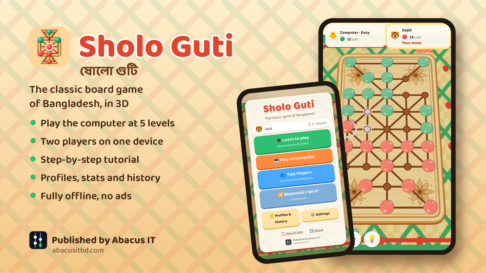
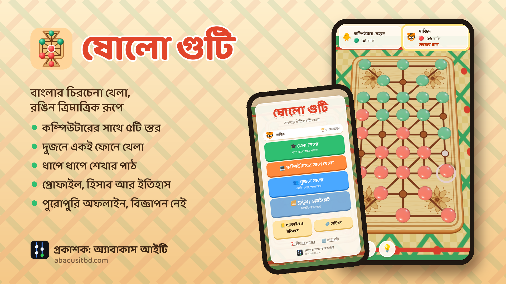

# Sholo Guti (ষোলো গুটি)

**The classic 16-guti board game of Bangladesh, in colourful 3D.** Free, offline, no ads. By [Abacus IT](https://abacusitbd.com).

## Download

| Platform | Get it |
|---|---|
| **Play in the browser** (iPhone, iPad, any computer) | **[Play now](https://riadul.github.io/sholo-guti-download/play/)** |
| **Android** 8+ | [SholoGuti.apk](https://github.com/riadul/sholo-guti-download/releases/latest/download/SholoGuti.apk) (allow "install unknown apps" when asked) |
| **Windows** 10/11 | [SholoGuti-Setup-x64.exe](https://github.com/riadul/sholo-guti-download/releases/latest/download/SholoGuti-Setup-x64.exe) |
| **Linux** | [Snap Store](https://snapcraft.io/sholo-guti): `sudo snap install sholo-guti`, or the AppImage / .deb on the [releases page](https://github.com/riadul/sholo-guti-download/releases/latest) |

## About the game

Sholo Guti ("sixteen pieces", also called 16 Guti or Sixteen Soldiers) is the much-loved village board game of
Bangladesh, played for generations on courtyards, verandas and carved wooden boards.

- Play the computer at 5 levels (Beginner, Easy, Medium, Hard, Expert), or a friend on one device
- Step-by-step tutorial and a full "How to play" guide
- A carved wooden board with alpona art on a woven shital pati mat; glossy cartoon gutis, combos and confetti
- Player profiles with avatars, statistics and match history; saved after every move; undo and hints
- Village house rules (must capture, full chains), four colour themes, Bangla and English
- Fully offline, no ads, no account, no data collected

**How to play:** each side has 16 gutis. Take turns moving one guti along a line to the next empty point. Jump
over an enemy guti next to yours, to the empty point behind it, to capture it, and keep jumping if you can.
Capture all enemy gutis, or leave them with no move, to win.

---

## বাংলায়

**বাংলার চিরচেনা ষোলো গুটি খেলা, রঙিন ত্রিমাত্রিক রূপে।** সম্পূর্ণ ফ্রি, অফলাইন, কোনো বিজ্ঞাপন নেই। প্রকাশক: [অ্যাবাকাস আইটি](https://abacusitbd.com)।

| কোথায় খেলবে | ডাউনলোড |
|---|---|
| **ব্রাউজারে** (আইফোন, আইপ্যাড, যেকোনো কম্পিউটার) | **[এখনই খেলো](https://riadul.github.io/sholo-guti-download/play/)** |
| **অ্যান্ড্রয়েড** ৮ বা নতুন | [SholoGuti.apk](https://github.com/riadul/sholo-guti-download/releases/latest/download/SholoGuti.apk) (জিজ্ঞেস করলে "অজানা অ্যাপ ইনস্টল" চালু করো) |
| **উইন্ডোজ** ১০/১১ | [SholoGuti-Setup-x64.exe](https://github.com/riadul/sholo-guti-download/releases/latest/download/SholoGuti-Setup-x64.exe) |
| **লিনাক্স** | [স্ন্যাপ স্টোর](https://snapcraft.io/sholo-guti): `sudo snap install sholo-guti` |

- কম্পিউটারের সাথে ৫টি স্তর (নতুন, সহজ, মাঝারি, কঠিন, ওস্তাদ), অথবা একই ফোনে বন্ধুর সাথে
- আসল বোর্ডে ধাপে ধাপে শেখার পাঠ
- আলপনা আঁকা কাঠের বোর্ড, শীতলপাটি, চকচকে কার্টুন গুটি
- নিজের প্রোফাইল, হিসাব আর খেলার ইতিহাস; প্রতিটি চালে সেভ
- গ্রামের নিজস্ব নিয়ম, চারটি রং, বাংলা আর ইংরেজি

**কীভাবে খেলবে:** দুজনের ১৬টি করে গুটি। পালা করে একটি গুটি দাগ ধরে পাশের খালি ঘরে সরাও। পাশে প্রতিপক্ষের গুটি আর তার
ঠিক পেছনের ঘর খালি থাকলে লাফ দিয়ে ওটা খেয়ে ফেলো, আবার খাওয়া গেলে আবার লাফ দাও। সব গুটি খেয়ে ফেললে, বা প্রতিপক্ষ আর
চাল দিতে না পারলে, তুমি জিতবে।

*Keywords: sholo guti, shologuti, 16 guti, sixteen soldiers, bead game, Bangladesh board game, ষোলো গুটি, ষোল গুটি, ষোলগুটি, ১৬ গুটি, গুটি খেলা*
